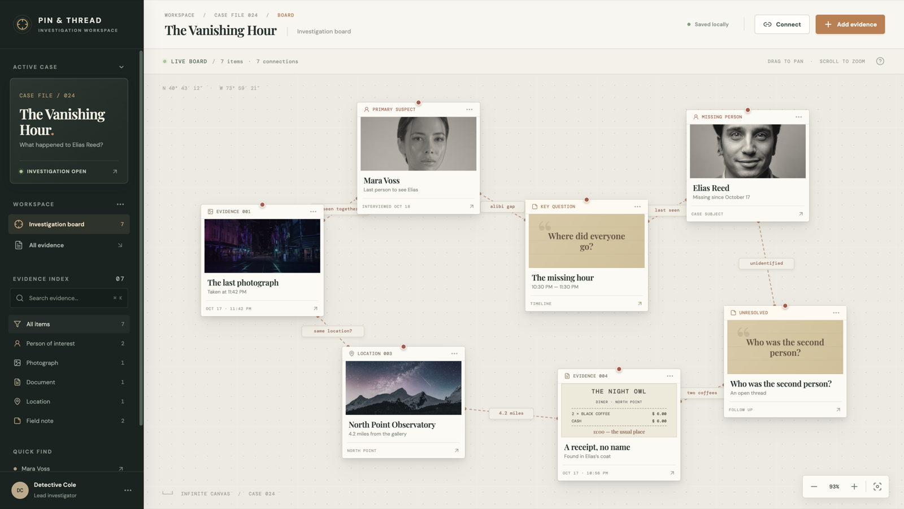
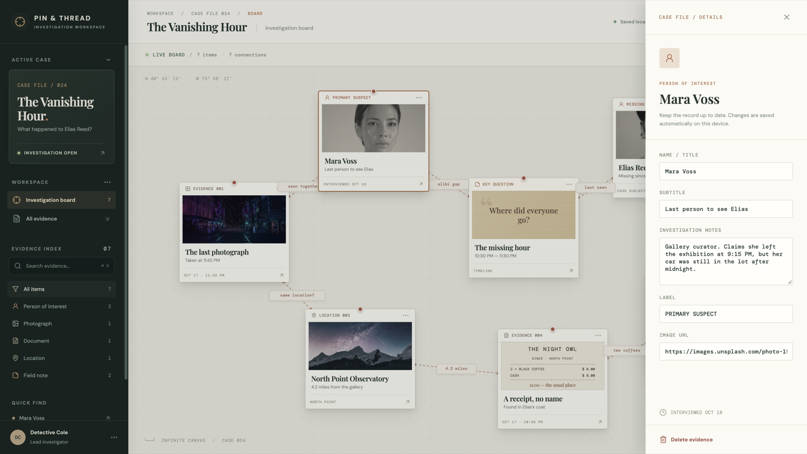
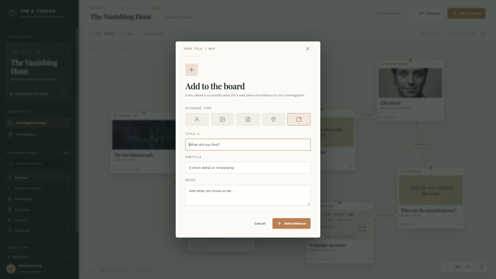

# Pin & Thread — Infinite Detective Board

A browser-based investigation workspace built with React, TypeScript, and Vite. The included fictional case, **The Vanishing Hour**, provides a ready-to-explore demonstration.

## Run locally

```bash
npm install
npm run dev
```

Open the local URL printed by Vite. Run `npm test` for board-logic tests and `npm run build` for a production build and TypeScript check.

## Work the case

- Drag the empty canvas to pan; scroll, use `+` / `−`, or the zoom controls to zoom. **Fit board** frames all evidence.
- Drag cards to rearrange them. Click one to edit its title, notes, label, or image URL in the details panel.
- Use **Add evidence** to create a person, photograph, document, location, or note. It appears in the center of the current view.
- Use **Connect**, then select two cards to draw a relationship. Click a connection label to rename or delete it.
- Search or filter the evidence index to highlight matches. Select a card under **Quick find** to center it.
- Press `Delete` to remove selected evidence or a connection, and `Escape` to dismiss a selection or dialog.

The board is saved in this browser's local storage. It is intentionally a local, single-case demo: it does not sync across devices or users. The sample photographs and web fonts load from external services; the app remains usable without them.

## UI preview

| Investigation canvas | Evidence details |
| --- | --- |
|  |  |

| Add evidence | Connect clues |
| --- | --- |
|  |  |
